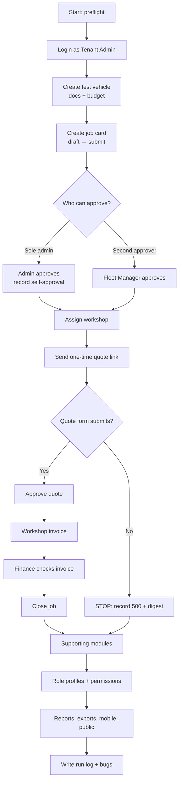
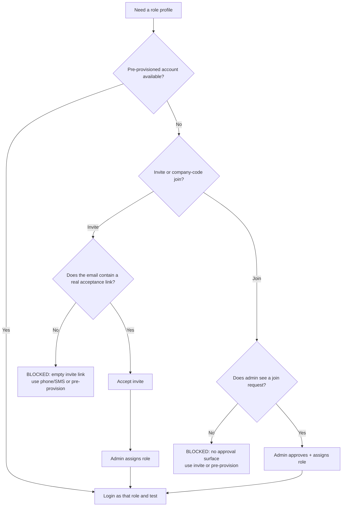

# Fleet OTG — Manual Regression Test Runbook

**Purpose:** a step-by-step manual test flow for the current Fleet OTG build, including the known blockers and the role-by-role checks.  
**Target:** `https://www.fleetotg.com`  
**Workspace:** `destinsolutions`  
**Last updated:** 2026-11-08, corrected for the live build `29a0446` (tenant migrations up to 0039 applied)  
**Related:** [Second regression report](reports/2026-11-08_1933/report.md); `docs/RESUME.md` (what is live); ADR-072 (approval rule) and ADR-073 (tests as a non-superuser account)

> Use a **test/trial workspace** and a new `MT-<date>-` prefix. Do not edit or delete the existing `QA-` or `R2-` records.

---

## 1. How to use this document

1. Work top to bottom.
2. Tick each checkbox and write the actual result in the **Result** column or in the run log at the end.
3. For every failure, capture:
   - page URL
   - screenshot before and after
   - browser console error
   - network response status and response body
   - the server “quote …” digest if shown
   - the test record name/ID
4. If a **STOP** condition is hit, do not continue into dependent tests; mark them `BLOCKED`.
5. Use the **Run log** and **Bug log** templates in §17–§18.

### Status values

| Status | Meaning |
|---|---|
| PASS | Expected result observed |
| FAIL | Wrong result, error, or data not saved |
| BLOCKED | Cannot run because a prerequisite/known defect blocks it |
| NOT TESTED | Deliberately skipped |

---

## 2. Preflight checklist

- [ ] **MT-PRE-01** Confirm this is the intended test environment, not a customer’s live workspace.
- [ ] **MT-PRE-02** Confirm the admin login works. Record the email only; never put the password in this file.
- [ ] **MT-PRE-03** Confirm the workspace name and plan (Basic/Pro, trial end date).
- [ ] **MT-PRE-04** Use desktop Chrome at 1440×900 or 1440×1000.
- [ ] **MT-PRE-05** Have a second browser/profile ready for clean-session tests (incognito is fine).
- [ ] **MT-PRE-06** Have a **test inbox** ready for workshop links and invitations.
- [ ] **MT-PRE-07** Have a **test phone/SMS inbox** ready if role invitations are being tested.
- [ ] **MT-PRE-08** Create a test prefix, for example `MT-20261108-01`.
- [ ] **MT-PRE-09** Open DevTools → Console and Network, with “Preserve log” on.
- [ ] **MT-PRE-10** Confirm no real customer data will be created, emailed, or charged.

**Do not use** a real customer email, a real workshop phone, or a real payment card for these tests.

---

## 3. Overall test flow



**Plain-text fallback:**

```text
Preflight → Login → Vehicle → Job → Approval
       → Workshop → Quote → Invoice → Close
       → Supporting modules → Roles → Mobile/Public → Report
```

### Stop conditions

Stop the dependent flow and mark it `BLOCKED` if:

- Job-card quote submission returns HTTP 500 or a “SOMETHING WENT WRONG” page (it did until tenant 0039; if it happens again, record the digest: the Admin, Activity screen has the cause).
- An invitation email has no acceptance link (fixed for new invitations; two older emails still have the empty link, so use Send a new link).
- A person who joined by company code **and typed the WhatsApp code** still has no pending request visible to the administrator. (Without the code, no request is visible, by design: ADR-055.)
- A test action would email/message/charge a real person.
- Test data appears in the wrong workspace or another company’s data is visible.

---

## 4. Role-provisioning decision flow

Use this before any role-specific testing.



**Current status (live build `29a0446`):**

- New invitation emails carry the real “Create my account” link. Invitations sent before the fix have an empty link: use **Send a new link** on those rows.
- Company-code join is confirmed by a 6-digit code sent to the person's **WhatsApp** (ADR-055). The request is invisible to the administrator until the code is typed. A dummy phone number cannot confirm it, so this path needs a real WhatsApp number. Before the code is typed, login shows “No workspace yet” with an explanation and a link to enter the code.
- Role accounts still need a real phone or WhatsApp number (invitation by phone, or the code), or pre-provisioned accounts.

---

## 5. Test data to create

Use one prefix for the whole run, e.g. `MT-20261108-01`.

| Item | Suggested value | Notes |
|---|---|---|
| Vehicle registration | `MT-20261108-01` | Toyota Corolla 2022, petrol |
| Odometer | `60,000` km | Use a realistic value |
| Insurance/fitness/token | Future dates | e.g. 2027-06-30, 2027-03-31, 2027-06-30 |
| Budget | `500,000` PKR | 2026 vehicle budget |
| Vendor | `MT-20261108 Workshop` | Use a test inbox/phone only |
| Job card | Created by the flow | Use reason “Brake wear” |
| Policy | `MT-20261108 Policy` | Small PDF or image |
| Role users | `MT FM`, `MT Requester`, etc. | Use a test inbox/phone |

**Do not** reuse the existing `QA-OTG-001`, `QA-20261108-*`, or `R2-*` records as your own.

---

## 6. Authentication and access

### 6.1 Valid login

- [ ] **MT-AUTH-01** Open `/login`.
- [ ] Enter the admin email and password.
- [ ] Click **Sign in**.

**Expected:** dashboard loads at `/w/destinsolutions`; no console error; sidebar and workspace name visible.

**Actual:** ______________________________________________

### 6.2 Invalid login

- [ ] **MT-AUTH-02** Open `/login` in a clean session.
- [ ] Enter the admin email and a deliberately wrong password.
- [ ] Click **Sign in**.

**Expected:** stays on `/login`, shows an error, does not reveal whether the email exists, no dashboard.

**Actual:** ______________________________________________

### 6.3 Sign out

- [ ] **MT-AUTH-03** Sign in, then click **Sign out**.

**Expected:** session ends and the login page appears; Back does not restore the workspace.

**Actual:** ______________________________________________

### 6.4 Unauthenticated workspace access

- [ ] **MT-SEC-01** In a clean session, open `/w/destinsolutions`.

**Expected:** redirects to `/login`; no workspace data.

**Actual:** ______________________________________________

### 6.5 Unauthorized direct route

- [ ] **MT-SEC-02** As the admin, open `/w/destinsolutions/vehicle-requests/new`.

**Expected:** “YOU DO NOT HAVE ACCESS TO THIS PAGE”; no data. Note the HTTP status.

**Actual:** ______________________________________________

**Current observation:** the page returns HTTP 200, not 403. This is a low-priority status issue, not a data leak.

### 6.6 Public pages and links

- [ ] **MT-PUB-01** Open `/`, `/features`, `/about`, `/contact`, `/pricing`, `/compare`, `/login`, `/signup`, `/join`, `/terms`, `/privacy`, `/forgot-password`.

**Expected:** each returns a complete page, no 404/5xx, no broken primary navigation.

**Actual:** ______________________________________________

- [ ] **MT-PUB-02** Check the main internal links from the homepage and Features page.

**Expected:** no 404/5xx.

**Actual:** ______________________________________________

---

## 7. Dashboard and navigation

- [ ] **MT-DASH-01** Open **Dashboard**.
- [ ] Verify the header shows the workspace, date, and active vehicle count.
- [ ] Verify the cards: Awaiting approval, Open job cards, Spend this month, Vehicles over budget, Service due, Documents expiring.
- [ ] Click each card and confirm it opens the matching filtered page.
- [ ] **MT-DASH-02** Reload the page; confirm the counts remain consistent.
- [ ] **MT-NAV-01** Visit every sidebar module once and confirm it returns a page, not a 404.

**Expected:** consistent counts, no console errors, every module loads.

**Actual:** ______________________________________________

---

## 8. Vehicles

### 8.1 Blank-form validation

- [ ] **MT-VEH-01** Go to **Vehicles → Add a vehicle**.
- [ ] Click **SAVE VEHICLE** without filling anything.

**Expected:** an inline message such as “Fill in the fields marked with a star”; no vehicle created.

**Actual:** ______________________________________________

### 8.2 Full vehicle creation

- [ ] **MT-VEH-02** Fill:
  - registration `MT-…`
  - make Toyota, model Corolla, year 2022, fuel Petrol
  - VIN, engine number, colour, class Car
  - driver/custodian and department
  - holding date
  - odometer 60,000
  - last oil change date/km
  - insurance, fitness, token-tax expiry dates
  - 2026 budget 500,000
- [ ] Click **SAVE VEHICLE**.

**Expected:** vehicle detail page opens; budget and documents appear; no 500; all entered values visible.

**Actual:** ______________________________________________

**Regression note:** this exact path previously returned HTTP 500 (a blank policy number on the insurance record). It is fixed: a blank policy number is saved as “Not recorded yet”, and any other missing required value now gives a plain message. If it fails, record the digest and stop.

### 8.3 Vehicle list and filters

- [ ] **MT-VEH-03** Open **Vehicles**.
- [ ] Filter by **Department** and click **Show**.
- [ ] Type the registration in the search box and press **Enter**.
- [ ] Type the registration and click **Show**.

**Expected:** department filter works; Enter search returns one row; **Show** should also keep the text query.

**Actual:** ______________________________________________

**Current behaviour:** the search box and the department filter are one form, so **Show** and **Enter** both send the text and the department. (Before the fix, Show dropped the text.)

### 8.4 Vehicle detail management

- [ ] **MT-VEH-04** Open the test vehicle.
- [ ] Assign a holder and department.
- [ ] Change status Active / In workshop / Inactive and update.
- [ ] Verify the budget panel and the documents tab.

**Expected:** each change saves, shows a confirmation, and appears in the activity/history.

**Actual:** ______________________________________________

### 8.5 Vehicle export

- [ ] **MT-VEH-05** Click **Export CSV** on Vehicles.
- [ ] Open the CSV.

**Expected:** one header row and one row per vehicle, including the test vehicle.

**Actual:** ______________________________________________

---

## 9. Job cards and approval

### 9.1 Create a draft

- [ ] **MT-JOB-01** Go to **Job cards → New job card**.
- [ ] Select the test vehicle, enter odometer 60,100.
- [ ] Choose reason **Brake wear**, write at least 10 characters.
- [ ] Add one Part line: “Front brake pads”, qty 1, unit cost 15,000.
- [ ] Click **Save draft**.

**Expected:** detail page opens with status **Draft**; activity shows Draft; nothing is sent.

**Actual:** ______________________________________________

### 9.2 Submit for approval

- [ ] **MT-JOB-02** Open the draft, click **Submit for approval**.

**Expected:** status **Awaiting approval**; approval queue shows it if another approver exists.

**Actual:** ______________________________________________

### 9.3 Self-approval rule

- [ ] **MT-JOB-03** Open the submitted card as the person who raised it.
- [ ] Read the decision panel.

**Expected (current ADR-029):**
- If the administrator is the **only active approver**: the panel explains that the administrator raised it and may decide it; the audit trail will show both actions.
- If another eligible approver exists: no self-approve option; the card must go to the other person.

**Actual:** ______________________________________________

- [ ] If the admin is the sole approver, approve the card and record the status. Note: the record names who raised and who approved; there is no separate “self-approved” flag.
- [ ] **Stop here if the card can be self-approved when a second eligible approver exists**; that is the B-rule regression.

### 9.4 Approve and assign a workshop

- [ ] **MT-JOB-04** Select the test workshop.
- [ ] Add a note.
- [ ] Click **Approve and assign**.

**Expected:** status **Workshop assigned**; activity shows the approver, time, and workshop; budget impact appears.

**Actual:** ______________________________________________

### 9.5 Return and reject (optional, second job)

- [ ] **MT-JOB-05** Create a second draft and submit it.
- [ ] As the approver, choose **Return for edit** with a note.

**Expected:** status **Sent back for edit**; the requester sees the note.

- [ ] Create a third draft and choose **Reject** with a note.

**Expected:** status **Rejected**; a note is required; no workshop assignment.

**Actual:** ______________________________________________

### 9.6 Job list and export

- [ ] **MT-JOB-06** Filter by status; search by job number.
- [ ] Export CSV.

**Expected:** rows match the filters; CSV has the same statuses.

**Actual:** ______________________________________________

---

## 10. Workshop quotation

### 10.1 Send the one-time link

- [ ] **MT-QUOTE-01** On the workshop-assigned job, click **Email the link** (or **Send the link by phone** if you have a test phone).
- [ ] Open the test inbox/phone.

**Expected:** a message arrives with a link like `https://www.fleetotg.com/q/<token>`; the link works once.

**Actual:** ______________________________________________

### 10.2 Open the link as the workshop

- [ ] **MT-QUOTE-02** Open the link in a clean/incognito browser.
- [ ] Verify it shows the workshop name, job number, vehicle, and the requester’s description.

**Expected:** no login required; form visible.

**Actual:** ______________________________________________

### 10.3 Submit the estimate

- [ ] **MT-QUOTE-03** Add one line:
  - Part, “Front brake pads”, qty 1, unit cost 14,000
  - days needed 2, warranty 3 months, valid until a future date
- [ ] Click **Send estimate**.

**Expected:** success message; the job card status becomes **Quote received**; the quote appears under Quotations; the link no longer works.

**Actual:** ______________________________________________

**STOP if:** HTTP 500 or “SOMETHING WENT WRONG”. The digest `1761589759` was the old fault (a database permission on the workshop link, fixed by tenant 0039). Record any digest and mark quote approval and invoice as BLOCKED.

### 10.4 One-time link reuse

- [ ] **MT-QUOTE-04** Reopen the same link in a new session.

**Expected:** “link used/expired”; no second submission.

**Actual:** ______________________________________________

### 10.5 Compare and approve the quote

- [ ] **MT-QUOTE-05** As the fleet office, open the job card/Quotations.
- [ ] Compare the quote with the requester’s estimate.
- [ ] Approve the quote.

**Expected:** status **Quote approved**; activity records who approved it and when.

**Actual:** ______________________________________________

---

## 11. Invoice and close

> **Current blocker:** if §10.3 returned 500, skip this whole section and mark it BLOCKED.

- [ ] **MT-INV-01** Open the job after quote approval; use the invoice/workshop link or **Invoices**.
- [ ] Enter the invoice lines and amount.
- [ ] Submit the invoice.

**Expected:** invoice appears under **Invoices → To check**.

- [ ] **MT-INV-02** As Finance, open the invoice.
- [ ] Check it against the approved quote.
- [ ] Confirm the approver of the job cannot verify the invoice.
- [ ] Mark it checked/paid as appropriate.

**Expected:** only Finance (or the allowed role) can verify; the approver cannot verify their own job’s invoice; status updates correctly.

**Actual:** ______________________________________________

- [ ] **MT-INV-03** Close the job.

**Expected:** status **Closed**; cost lands on the vehicle/budget/report; no further edits.

**Actual:** ______________________________________________

---

## 12. Role-by-role test plan

> **Prerequisite:** the role account must be active. The current invite/join paths are blocked; use pre-provisioned accounts or a test phone/SMS inbox.

For every role:

1. Login in a clean browser.
2. Record the landing page and visible menu.
3. Perform the **allowed** action.
4. Try the **denied** action (UI and direct URL).
5. Record the result.

### 12.1 Tenant Admin

- [ ] **MT-ROLE-ADMIN-01** All modules visible.
- [ ] **MT-ROLE-ADMIN-02** Manage people, settings, vehicles, budgets.
- [ ] **MT-ROLE-ADMIN-03** Approve a job when eligible.
- [ ] **MT-ROLE-ADMIN-04** Configure company code / invites.

**Expected:** full administrative access, subject to the self-approval rule.

### 12.2 Fleet Manager

- [ ] **MT-ROLE-FM-01** Login; dashboard loads.
- [ ] **MT-ROLE-FM-02** Approve a job raised by someone else.
- [ ] **MT-ROLE-FM-03** Choose a workshop and approve a quote.
- [ ] **MT-ROLE-FM-04** Review an odometer reading.
- [ ] **MT-ROLE-FM-05** Edit a budget and a service rule.
- [ ] **MT-ROLE-FM-06** Add/edit a vehicle.
- [ ] **MT-ROLE-FM-07** Try **Users and roles** and **Service rules**; record whether denied.

**Expected:** allowed fleet actions work; people/settings management denied if the matrix says so.

### 12.3 Requester

- [ ] **MT-ROLE-REQ-01** Login; raise a job card for an allowed vehicle.
- [ ] **MT-ROLE-REQ-02** View own job/vehicle.
- [ ] **MT-ROLE-REQ-03** Try to approve a job; must be denied.
- [ ] **MT-ROLE-REQ-04** Try to open Budgets/Users/Settings; record denials.

**Expected:** can raise; cannot approve or administer.

### 12.4 Finance

- [ ] **MT-ROLE-FIN-01** Login; open **Invoices**.
- [ ] **MT-ROLE-FIN-02** Verify an invoice against the approved quote.
- [ ] **MT-ROLE-FIN-03** View costs/reports.
- [ ] **MT-ROLE-FIN-04** Try to approve a job/add a vehicle; record denials.

**Expected:** invoice verification works; job approval/vehicle administration denied.

### 12.5 HR

- [ ] **MT-ROLE-HR-01** Login; create a vehicle request for an employee.
- [ ] **MT-ROLE-HR-02** View the decision/status.
- [ ] **MT-ROLE-HR-03** Try to decide your own request; must be denied.
- [ ] **MT-ROLE-HR-04** Try a fleet-manager-only action; record denial.

**Expected:** HR request creation works; self-decision denied; no fleet approval.

### 12.6 Auditor

- [ ] **MT-ROLE-AUD-01** Login; view reports/costs.
- [ ] **MT-ROLE-AUD-02** Try to edit a budget, vehicle, or job; record denials.

**Expected:** read-only cost/report access; no edits.

### 12.7 Logistics

- [ ] **MT-ROLE-LOG-01** Login; verify department/vehicle scope.
- [ ] **MT-ROLE-LOG-02** Raise/approve within scope and limit.
- [ ] **MT-ROLE-LOG-03** Try another department’s vehicle; must be denied.
- [ ] **MT-ROLE-LOG-04** Try a company-wide report/admin action; record denial.

**Expected:** department-scoped access only; spending limit enforced.

### 12.8 Gate security

> The gate-pass module is deferred (V1.3, ADR-067), and trips are not in a Basic workspace, so there may be no “intended gate action” to try. Record what this role sees and mark the rest NOT TESTED.

- [ ] **MT-ROLE-GATE-01** Login; record the visible modules.
- [ ] **MT-ROLE-GATE-02** Try the intended gate action (vehicle/trip/check-in as configured).
- [ ] **MT-ROLE-GATE-03** Try an admin action; record denial.

**Expected:** only the gate-security surface; no cost/admin access.

### 12.9 Vendor

Vendors do not have accounts: a workshop works only from the one-time link, and a signed-in workshop login exists only for the older flow.

- [ ] **MT-ROLE-VENDOR-01** Open the `/q/` quote link in a clean browser.
- [ ] Confirm no login is required.
- [ ] Confirm the link is one-time and job-scoped.

**Expected:** quote form only; no access to any other job or workspace.

---

## 13. Two-user approval and the B rule

Use this once a second eligible approver is active.

### 13.1 Baseline — one approver

- [ ] **MT-B-01** Ensure the admin is the only active approver.
- [ ] Raise a job as the admin and open the decision panel.

**Expected:** admin may self-approve; UI says the record will show both actions.

### 13.2 Add a second approver

- [ ] **MT-B-02** Activate a Fleet Manager.
- [ ] As the admin, raise a new job and open the decision panel.

**Expected:** no self-approve option; the Fleet Manager must approve.

### 13.3 Second approver decides

- [ ] **MT-B-03** Login as the Fleet Manager; approve the admin’s job.

**Expected:** allowed; activity records the manager, not the admin.

### 13.4 Disable the second approver

- [ ] **MT-B-04** Deactivate the Fleet Manager.
- [ ] As the admin, raise and open another job.

**Expected:** the exception returns; admin may self-approve again, clearly flagged.

### 13.5 Re-enable

- [ ] **MT-B-05** Reactivate the Fleet Manager; repeat MT-B-02.

**Expected:** self-approval blocked again immediately.

---

## 14. Supporting modules

### 14.1 Vendors

- [ ] **MT-VEND-01** Add `MT-… Workshop` with a test email/phone.
- [ ] **MT-VEND-02** Edit contact details.
- [ ] **MT-VEND-03** Block/unblock the vendor; confirm it disappears/appears in job assignment.

**Expected:** changes save; blocked vendors cannot be assigned.

### 14.2 Budgets

- [ ] **MT-BUD-01** Add a 2026 vehicle budget.
- [ ] **MT-BUD-02** Add an overlapping budget; expect a clear overlap error.
- [ ] **MT-BUD-03** Check the default “Over or near” view; click **Show all**.
- [ ] **MT-BUD-04** Export CSV.

**Expected:** budget saves, overlap rejected, on-track budgets are discoverable via All, CSV matches.

### 14.3 Compliance

- [ ] **MT-COMP-01** Add insurance, fitness, and token-tax documents to the test vehicle.
- [ ] **MT-COMP-02** Add a document expiring within 30 days.
- [ ] **MT-COMP-03** Check the dashboard “Documents expiring” count.

**Expected:** documents save, expiry count updates, no duplicate records.

### 14.4 Accidents and challans

- [ ] **MT-ACC-01** Log a minor accident with a 10+ character description.
- [ ] **MT-ACC-02** Log a challan with amount/reference.
- [ ] **MT-ACC-03** Click **Mark paid**; verify status Paid and paid date.
- [ ] **MT-ACC-04** Try **Disputed**; verify status.

**Expected:** records save, status buttons work, exports include them.

### 14.5 Odometer

- [ ] **MT-ODO-01** Start a new monthly cycle with a due date.
- [ ] **MT-ODO-02** Open the month; send a driver link (if test phone available).
- [ ] **MT-ODO-03** Submit a reading from the driver link.
- [ ] **MT-ODO-04** Review/approve the reading; verify the vehicle odometer updates.

**Expected:** cycle and reading work; one-time link; stale/high-reading rules apply.

### 14.6 Settings / service rules

- [ ] **MT-SET-01** Save the current rules unchanged; expect “Nothing changed.”
- [ ] **MT-SET-02** Change one warning value, save, verify, then revert.

**Expected:** changes save and affect the “vehicles due” count; revert restores it.

### 14.7 Maintenance policy

- [ ] **MT-POL-01** Upload a small PDF, PNG, or JPEG policy.
- [ ] **MT-POL-02** Verify the current policy and “Open …” link.
- [ ] **MT-POL-03** Click **Read this policy**; review the extracted rules and confidence.
- [ ] **MT-POL-04** Tick/apply selected rules; verify the numeric fields update.
- [ ] **MT-POL-05** Revert to the original values.

**Expected:** upload succeeds for all three formats; scan offers rules; applying updates only selected rules.

### 14.8 Reports and exports

- [ ] **MT-REP-01** Run 3/6/12/24-month filters.
- [ ] **MT-REP-02** Export costs by vehicle, flags, cost/km, workshop time.
- [ ] **MT-EXP-01** Export vehicles, job cards, budgets, accidents, challans.

**Expected:** totals reconcile with the records; CSV opens cleanly; no blank/duplicate rows.

### 14.9 Billing

- [ ] **MT-BILL-01** Open **Billing**; record plan, trial end, payment reference.
- [ ] **MT-BILL-02** Do **not** submit a payment. Check that the payment form is clear about test/dummy data.

**Expected:** read-only plan/trial data correct; no accidental charge.

### 14.10 Imports / offline form

- [ ] **MT-IMP-01** Open **Vehicles → Import data** and **Job cards → Offline form**.
- [ ] Download the template; inspect the columns.
- [ ] If safe, upload one test row and verify the record.

**Expected:** templates match the live fields; invalid rows are rejected with clear errors.

---

## 15. Mobile and public-site checks

- [ ] **MT-MOB-01** At 390×844, open Dashboard, Job cards, Vehicles.
- [ ] Check for page-level horizontal scrolling (`document.documentElement.scrollWidth` vs `window.innerWidth`).

**Expected:** no horizontal overflow; tables scroll inside their container if needed.

**Current behaviour:** the dashboard's “Service due” table scrolls inside its panel; the page itself should not exceed 390px. (Before the fix it made the page 491px wide when the table had rows.) Test with at least one vehicle due for service.

- [ ] **MT-MOB-02** Open the login, signup, and join forms at 390px.

**Expected:** fields and buttons are usable; no cut-off primary action.

- [ ] **MT-PUB-03** Check the public homepage, pricing, and features at mobile width.

**Expected:** readable, no broken navigation.

---

## 16. Known issues and blockers (live build `29a0446`)

Use these as stop/known-issue notes, not as steps to “prove” again unless you are retesting a fix.

| Item | Status | What to do |
|---|---|---|
| Workshop quote 500 (digest 1761589759) | **Fixed** (tenant 0039). The invoice link and the emailed-estimate path had the same fault and are fixed too. | Retest §10.3 and §11. If it fails, record the digest. |
| Invitation email empty link | **Fixed** for new invitations. Two earlier emails still have the blank link. | Use **Send a new link** on those rows. |
| Company-code join, “No workspace yet” | **By design** (ADR-055): hidden until the person types the 6-digit WhatsApp code. The screen now explains the step. | Needs a real WhatsApp number. Dummy numbers cannot confirm. |
| Mobile dashboard overflow | **Fixed.** | Retest MT-MOB-01 with a vehicle due for service. |
| Vehicles search “Show” | **Fixed.** | Retest MT-VEH-03. |
| 403 vs 200 on a denied page | Open, low priority. | Note the status only. |
| File-storage admin check | Works, **for the platform operator only** (Admin, Settings, Check file storage). A tenant admin cannot see it. | Tenant testers use the policy upload as the storage check. |
| Role accounts, rule B (§13), driver odometer link | **Still blocked** without a real phone or WhatsApp number. | Pre-provision accounts, or use a real test number. |
| Quote to invoice to close with a real workshop | Not yet run on live. | Needs a test workshop with a real email (no real person). |

## 17. Run log

| Date/time | Tester | Environment | Build/commit | Result summary |
|---|---|---|---|---|
|  |  |  |  |  |

### Result rows

| Test ID | Status | Evidence | Notes |
|---|---|---|---|
| MT-PRE-01 |  |  |  |
| MT-AUTH-01 |  |  |  |
| MT-VEH-02 |  |  |  |
| MT-JOB-03 |  |  |  |
| MT-QUOTE-03 |  |  |  |
| MT-INV-02 |  |  |  |
| MT-ROLE-FM-01 |  |  |  |
| MT-B-02 |  |  |  |

Add one row per executed test.

---

## 18. Bug log template

| Field | Value |
|---|---|
| Bug ID |  |
| Title |  |
| Severity | Critical / High / Medium / Low |
| Area |  |
| Environment |  |
| Preconditions |  |
| Steps |  |
| Expected |  |
| Actual |  |
| HTTP status / digest |  |
| Console/network evidence |  |
| Screenshot |  |
| Test data IDs |  |
| Workaround |  |
| Status | Open / Fixed / Verified |

---

## 19. Cleanup and sign-off

- [ ] Cancel/close the test job cards if the app allows it.
- [ ] Mark test vehicles Inactive/Disposed, or delete them if a delete action exists.
- [ ] Remove/block the test vendor.
- [ ] Remove test budgets/documents/policy versions if safe.
- [ ] Deactivate test role accounts.
- [ ] Restore any global settings changed during the run.
- [ ] Confirm no real email/SMS/payment was sent.
- [ ] Attach the run log, screenshots, exports, and bug log to the report.

**Tester:** ____________________  
**Date:** ____________________  
**Sign-off:** ____________________

---

*Corrected on 2026-11-08 against the live build `29a0446`. Re-check §16 before assuming an item is still fixed or still open.*
